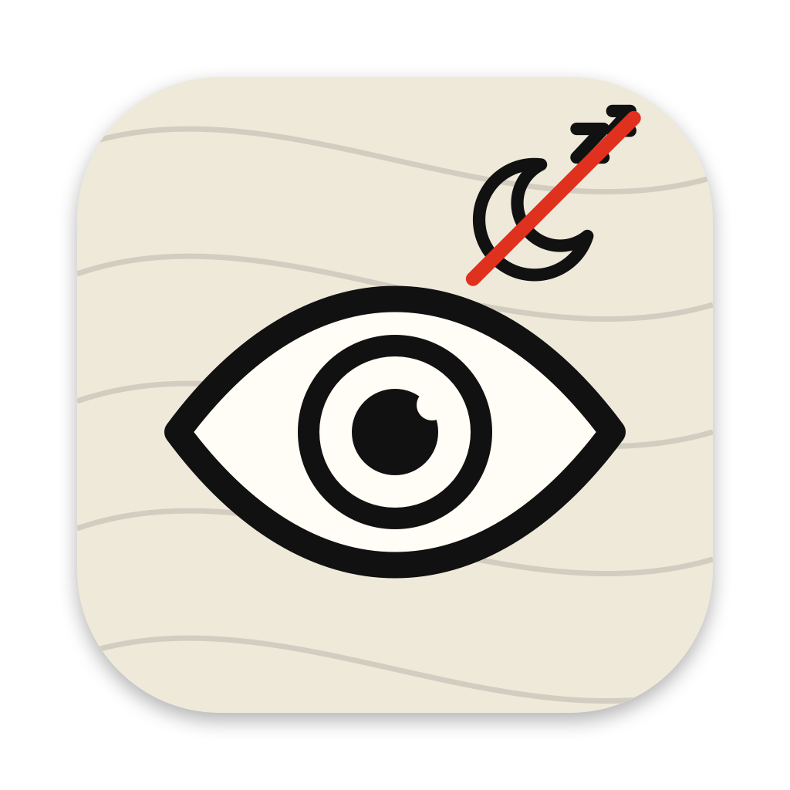

<p align="center"></p>

<h1 align="center">Lidless</h1>

<p align="center"><b>Shut the lid. Keep the Mac running.</b></p>

One eye in your menu bar. Click it open and your Mac stops sleeping, lid shut and all. Click it closed and it's a normal Mac again.

Your build keeps building. Your download keeps downloading. Your agents keep cooking. You go get lunch.

| | Mode | Close the lid and... |
|---|---|---|
| 👁 | **Awake** | it keeps running |
| 😌 | **Normal** | it sleeps |

Left-click to flip. Right-click for the menu.

## Get it

No download. You build your own, which takes about a minute. You need [Rust](https://rustup.rs) and `jq`.

```
git clone https://github.com/jellis206/lidless && cd lidless
scripts/bundle.sh --install
```

That drops `Lidless.app` into `/Applications` and opens it. The first click asks for your Mac password, once. Every click after that is instant.

The build is signed for your Mac only, so don't AirDrop the app to a friend. Send them this repo.

## What you get

- **Lid-shut awake.** `caffeinate` only stops idle sleep; close the lid and you're asleep anyway. Lidless blocks both, so you can retire the `caffeinate` tab.
- **A screen that fades out.** Shut the lid and the display eases down to black. Open it and it eases back to where you had it.
- **A fuse.** Mac running hot, or on battery at 20% or less? Lidless switches itself off and tells you, because a laptop cooking in a backpack is a bad day. You can disable this in the menu. Don't.
- **No mess on quit.** Quit and normal sleep comes back. So does your brightness.
- **Open at Login**, if you ask for it. It doesn't help itself.

## It still locks

Lidless changes when your Mac *sleeps*, not when it *locks*.

- Walk away or close the lid: the screen goes off after your usual display-sleep time, and the Mac locks like it always does.
- In a hurry: lock it yourself with `⌃⌘Q` and it locks now.
- Either way, everything keeps running behind the lock screen.

Locked and still working. That's the whole point.

One gap: between closing the lid and the screen turning off, the Mac is awake and not yet locked. Leaving it somewhere sketchy? Lock first, then close.

## Under the hood

Small enough to read in one sitting: three Rust files, no networking, nothing but Apple's own frameworks.

Flipping sleep needs root. Your one password prompt runs `pmset disablesleep` and installs this, and only this, at `/etc/sudoers.d/lidless`:

```
you ALL=(root) NOPASSWD: /usr/bin/pmset -a disablesleep 0, /usr/bin/pmset -a disablesleep 1
```

Two exact commands, no password, nothing else. It's checked with `visudo` before it goes live. On a work Mac, your security tooling may notice the new file.

The fade uses Apple's private DisplayServices framework, because macOS has no public brightness API. If an update removes it, the fade stops and everything else carries on.

## Versus the original

This is a Rust port of [Alex McConnell's Lidless](https://github.com/alexiscodingbits/lidless). His idea, his icon, his MIT licence. What's different here:

| | |
|---|---|
| **New** | Screen fade on lid close and open |
| **New** | Eye icon: open for awake, closed for normal (was a moon with a slash) |
| **New** | Quitting restores normal sleep (the original left your Mac stuck awake) |
| **New** | Tests for the parsing, the sudoers rule and the fade |
| **Changed** | Rust instead of Swift |
| **Changed** | Open at Login is opt-in, not automatic |
| **Changed** | Build it yourself; no notarised download |
| **Gone** | The About menu item |

## Known quirks

- Hovering the icon shows no tooltip on macOS 27. Right-click instead; the menu says which mode you're in.

## Hack on it

```
cargo test               # the logic
cargo test -- --ignored  # the hardware: reads the lid, dips your screen for a blink
```

## Uninstall

1. Right-click → **Ask for Password Again…** (removes the sudoers rule)
2. Quit, then bin the app

Or by hand: `sudo rm /etc/sudoers.d/lidless && sudo pmset -a disablesleep 0`

## Licence

MIT. Original work © 2026 Alex McConnell.
